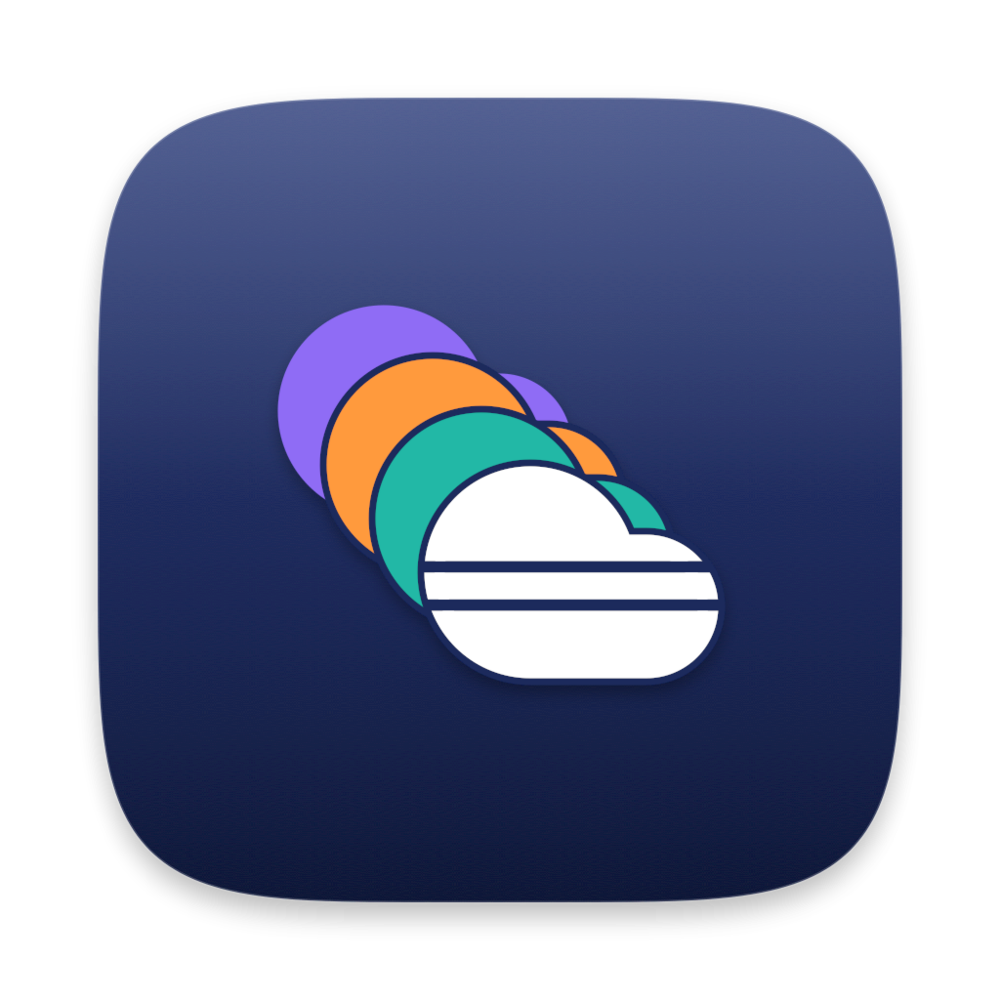

# App icon

The CloudDeck app icon. **Concept:** a deck of clouds. Four clouds (the Lucide `cloud` shape) spread like cards, one tint per cloud provider (violet, orange, teal, and the white front cloud sliced into stacked units). It says multicloud without any provider logo, and it uses no green, because green means "running" inside the app. No mascot, no lettering. Sizes up to 32px use a simplified version (three clouds, wider steps, no slices) so it stays readable in menus and the Dock.



## Files

| File | What it is |
|---|---|
| `clouddeck-icon.svg` | The master icon (1024 canvas, macOS 100px margin, superellipse squircle, baked-in drop shadow). Edit via `make_icon.py`, not by hand. |
| `clouddeck-icon-small.svg` | Simplified glyph used for the 16px and 32px sizes. |
| `clouddeck-icon-1024.png` | 1024px render with transparent corners, for docs and stores. |
| `AppIcon.iconset/` | The ten PNGs macOS expects (`icon_16x16.png` through `icon_512x512@2x.png`), transparent corners. |
| `AppIcon.icns` | The built macOS icon file, from `AppIcon.iconset`. Bundle this as the app icon. |
| `images/icon-sizes.png` | The icon at 256/128/64/32/16px on light and dark backgrounds. |
| `make_icon.py` | Generates all the SVGs, plus `export.html` and `export.json`. Colours live at the top of the file; cloud positions in `full()` and `small()`. |
| `export.html`, `export.json` | Generated by `make_icon.py`: one element per pixel size, and the manifest that tells the renderer to capture each. |
| `preview.html`, `shots.json` | The size board and its manifest (renders `images/icon-sizes.png`). |
| `concepts/`, `concepts*.py`, `preview-concepts*.html`, `shots-concepts*.json`, `images/icon-concepts-*.png` | The rejected exploration rounds (servers, ships, cards, clouds). History only. |

## Rebuilding

Run from this folder on a Mac with Xcode or the Command Line Tools (uses the renderer in `../render.swift`):

```bash
swiftc -swift-version 5 -o /tmp/clouddeck-render ../render.swift
python3 make_icon.py
CLOUDDECK_TRANSPARENT=1 /tmp/clouddeck-render export.json export.html export
/tmp/clouddeck-render shots.json preview.html images
# copy export/icon_<N>px.png into AppIcon.iconset using the names macOS expects:
#   16 -> icon_16x16, 32 -> icon_16x16@2x and icon_32x32, 64 -> icon_32x32@2x,
#   128 -> icon_128x128, 256 -> icon_128x128@2x and icon_256x256,
#   512 -> icon_256x256@2x and icon_512x512, 1024 -> icon_512x512@2x
iconutil -c icns AppIcon.iconset -o AppIcon.icns
```

`CLOUDDECK_TRANSPARENT=1` keeps the corners transparent; without it the PNGs get a white background.

## Not done yet

The icon is not wired into the app: no bundle, `Info.plist` entry, window icon or Linux `.desktop` icon uses it yet.
